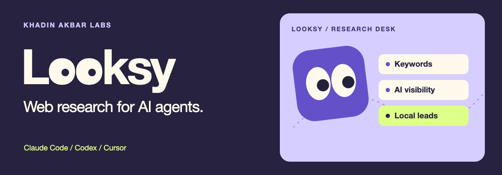

# Looksy

Ask your AI agent where your site ranks, which sources AI search cites, or which businesses operate in a city. Looksy finds the right Apify Actor and shows you the inputs and price before you run it.

One free, MIT-licensed plugin for Claude Code, Codex, Cursor and compatible local agents. [Download the visual catalog](https://github.com/khadinakbarlabs/local-lead-kit/releases/latest/download/catalog.html), browse [659 public Actors organized by task](docs/directory.md), or start with a [guided use case](skills/local-lead-kit/references/task-menu.md). Browsing is free. Connect your own **Apify API key** to run a task. Looksy shows the Actor and its current prices before you approve. Apify bills usage to your account.

| What do you want to do? | Try saying this |
|---|---|
| Keyword research | “Find promising keywords for a roofing company in the US. Show me the expected data and price first.” |
| SEO audit | “Which pages on my site should I fix first? Start with up to 20 pages.” |
| Search tracking | “Check my domain against these five keywords on US mobile. Save a dated baseline so I can compare it next month.” |
| AI visibility and citations | “Where does AI search mention my brand, which sources get cited, and how does that compare with my competitor?” |
| Local leads | “Find roofing companies in Austin and export public business contacts with a source for each.” |
| Humanization | “Make this product introduction sound like me. Keep every factual claim intact.” |
| Everything else | “What can I research about YouTube, marketplaces, property, or job openings?” |

**First prompt:** “Use Looksy. I want to **[outcome]** for **[business, website or topic]** in **[market]**. Find the right Actor, ask only for missing information, and show me an example of the output and the price before starting.”

### Install once

Pick your host below. All four downloads in the [latest release](https://github.com/khadinakbarlabs/local-lead-kit/releases/latest) contain the same skill and runtime. If you arrived from a Local Lead Kit tutorial, open **Local Leads** in Looksy. The installation ID remains `local-lead-kit` so existing installs and tutorial links keep working. Requires Python 3.11+ and permission to run local commands.

## Use it in Codex

Add `khadinakbarlabs/local-lead-kit` as a plugin marketplace in Codex, then install **Looksy** (listed under `local-lead-kit`). The equivalent CLI commands are:

```sh
codex plugin marketplace add khadinakbarlabs/local-lead-kit
codex plugin add local-lead-kit@local-lead-kit-marketplace
```

Reload the host, select Looksy (skill ID `local-lead-kit`) and describe your goal. The Maps campaign opens a local browser app; other tasks run inside your agent.

## Use it in Claude Code

```text
/plugin marketplace add khadinakbarlabs/local-lead-kit
/plugin install local-lead-kit@local-lead-kit-marketplace
```

Then use `/local-lead-kit:local-lead-kit` or ask Claude to open Looksy. This package requires a coding-agent host with local shell/browser access and Python 3.11 or newer. It is not a hosted cloud-chat app or an approved plugin-directory listing.

## Use it in Cursor

Unzip the **cursor** release into `~/.cursor/plugins/local/local-lead-kit/` with `.cursor-plugin/plugin.json` directly inside that folder, then reload Cursor. Ask the agent to use Looksy. See [Cursor plugin installation](https://cursor.com/docs/plugins).

## Other agents or no plugin installer

Import the **portable** release into a client that supports the [Agent Plugins standard](https://agent-plugins.org/). Keep the complete folder, including its Python runtime. A shell-enabled assistant can also open a clone and follow [the bundled skill](skills/local-lead-kit/SKILL.md) directly. Cloud-only chat clients without a local execution bridge cannot run this package.

## Try it without a token

Open **docs/catalog.html** from any unzipped download for a visual task browser with search and filters. It works offline; Store links open in your browser.

From a clone: `python3 -m local_lead_kit.toolbox menu`, then `python3 -m local_lead_kit.toolbox find "visibility"`. When you want a live plan, configure your own [Apify connection](skills/local-lead-kit/references/connection.md). The [run guide](skills/local-lead-kit/references/toolbox.md) covers input, approval and result recovery. The catalog includes all listings in the snapshot; the batch runner requires a verifiable default build, schema and pay-per-event price. Standby-only operations may require their own Store interface.

## Local Leads · Google Maps workspace

1. **Niche:** for example, roofing contractors.
2. **Territories:** one or several cities you actually serve.
3. **Target:** 250, 500, 1,000, or a custom value up to the current schema limit of 5,000.
4. **Run allowance:** review the current source prices and approve the specific plan before collection.
5. **Optional AI review:** describe your offer so the assistant can add useful evidence-led notes.

Targets are goals, not guaranteed result counts or market sizes. The app retains actual counts, partial coverage, missing contacts and uncertain addresses. The recorded trial used for the tutorial returned 18 businesses and 15 unique addresses; it does not establish that a 500- or 1,000-result campaign has been verified.

## What you receive

- Business rows with location, website, Maps context and contact coverage.
- Public website contact rows with validation reasons and extraction review flags.
- A searchable local results app and spreadsheet-safe CSV exports.
- Optional AI notes with confidence, cited sources and a next research step.
- Private run checkpoints so a known run can be observed again without another paid start.

The configured sources are [Google Maps Leads Scraper](https://apify.com/khadinakbar/google-maps-leads-scraper), [Bulk Website Contact Extractor](https://apify.com/khadinakbar/bulk-website-contact-extractor), and [Email Address Validator](https://apify.com/khadinakbar/email-address-validator). They are checked against their current builds and schemas before use. Source selection is visible; the package does not silently switch publishers.

SMTP and catch-all probing are disabled in this edition. Basic checks do not confirm an individual mailbox. A public address or an AI note does not establish buying intent or permission to send a message. The app sends no outreach.

## Standalone local app

```sh
git clone https://github.com/khadinakbarlabs/local-lead-kit.git
cd local-lead-kit
python3 -m local_lead_kit serve
```

Use your own Apify account and a securely configured `APIFY_TOKEN`. If the environment needs a private file, ask your assistant to prepare an empty owner-readable file, add the value yourself outside chat, then launch:

```sh
python3 -m local_lead_kit --env-file .env.local serve
```

The app prints a private, single-use launch link. Open it once; the ordinary local app URL replaces it after authentication. Keep launch links and keys out of recordings and public issues. A host's separate MCP OAuth session does not automatically populate the app's API credential.

No Python runtime dependencies, installer hooks, hosted MCP endpoint, publisher proxy or extra model API key are required. Apify collection is billed to your own account. Optional AI review uses your active Codex/Claude session and its normal usage. Keep that assistant active until the requested review is complete.

Data defaults to a private `local-lead-kit` folder under your home data directory. Select a different private folder with `--workspace`. Stop the local server when finished; any cloud run already started must still be checked by its saved run ID.

## Existing results and recovery

The CLI can import three known finished run IDs read-only, inspect campaign status, export results through the app, and apply the active assistant's analysis. See the bundled [skill](skills/local-lead-kit/SKILL.md) and [execution guide](skills/local-lead-kit/references/execution.md).

Uncertain paid starts keep their reservation and stop for inspection. They are never automatically repeated. Known runs can be observed again. A failed or incomplete upstream is not presented as a complete empty-market result.

## Development and verification

```sh
python3 -m unittest discover -s tests -v
python3 scripts/package_release.py
python3 scripts/validate_package.py
```

The tests exercise the worker with offline fixtures, authorization, reservations, duplicate handling, partial failures, paging and exports. Real build/schema/pricing reads and the saved tutorial-run import were checked separately. See [validation](docs/validation.md); native installation, live collection, and marketplace approval are distinct evidence.

[Privacy](PRIVACY.md) · [Security](SECURITY.md) · [Terms](TERMS.md) · [Support](SUPPORT.md) · [Architecture](docs/architecture.md) · [Art attribution](docs/art.md)
