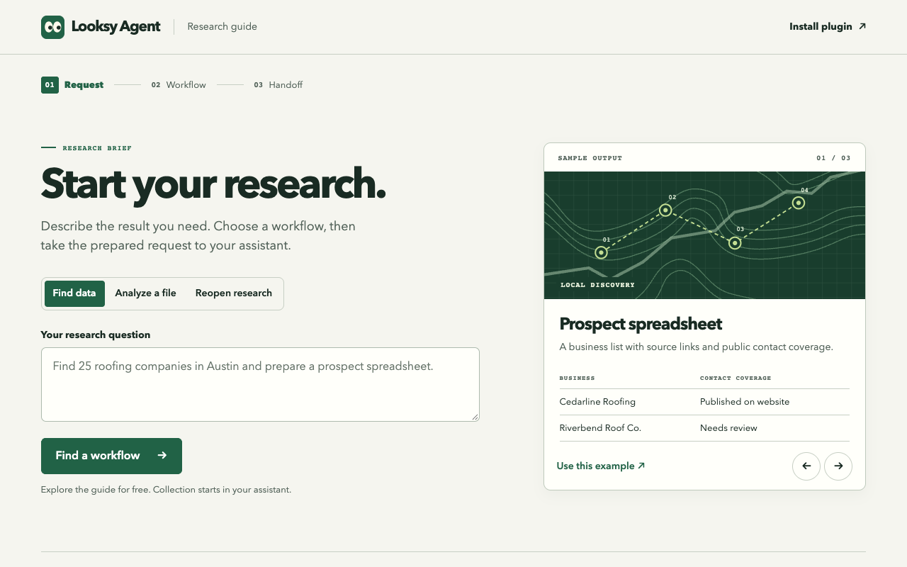

[](https://khadinakbarlabs.github.io/looksy/)

# Looksy Agent

Find public data, research a market, analyze an export, and turn the results into a useful report with the AI assistant you already use. Looksy Agent connects Claude Code, Codex and Cursor to a categorized directory of Apify Actors and reusable research workflows.

**36 research areas · 45 workflow recipes · 1,091 task entries · 659 cataloged Actors**

**Start with your goal.** Ask for a prospect spreadsheet, an SEO action plan, a product comparison, a content brief or a research report. Looksy Agent helps choose the sources, preserve your scope, preview charges, inspect the actual results and prepare the deliverable.

[Explore the research guide](https://khadinakbarlabs.github.io/looksy/) · [Browse all tasks](docs/tasks.md) · [Actor directory](docs/directory.md)

## Give this to your agent

```
set up Looksy - https://khadinakbarlabs.github.io/looksy/llms.txt
```

Your agent installs the plugin, you connect Apify once, and it can call every tool. [What the agent reads](docs/llms.txt)

**On claude.ai, Claude Desktop or ChatGPT?** No install and no API key: add a Looksy connector URL and sign in with Apify. [Connect Looksy anywhere](docs/connect.md)

## Ask for the job, not the tool

Looksy ships an MCP server (no dependencies, starts with the plugin) with six tools:

| Tool | What it does |
| --- | --- |
| `find_tools` | Plain-words job → ranked tools with **price per result, 30-day success rate, runs and users** |
| `list_jobs` | 36 named jobs (`maps.leads`, `keywords.volume`, `ai.visibility`, `ads.meta`, `email.verify` …) with example requests |
| `get_tool` | Live input fields, defaults and current prices. No key needed |
| `run_tool` | Runs on your Apify account with a hard `max_charge_usd`; returns the first rows and the cost |
| `get_run` | Status, cost and rows page by page |
| `account` | Your plan and this month's usage |

Every result reports `event_charges_usd`, `platform_usage_usd` and `total_usd`, so you always know what a run cost. Any MCP client can use it directly: `python3 skills/looksy/scripts/mcp.py` (stdio).

## Three ways to start

| What you need | Ask your assistant |
| --- | --- |
| Find new data | “Use Looksy Agent to find up to 25 roofers in Austin. Show the fields and costs before starting.” |
| Analyze data you have | “Use Looksy Agent to analyze my Apify CSV and prepare a competitor report. Ask which question the report should answer.” |
| Open recent research | “Use Looksy Agent to reopen my last research brief and show its saved results.” |

The guide takes three steps — your goal, a workflow starting point, and an editable assistant handoff. It includes labeled example deliverables, research areas, reusable workflows, an editable request for your assistant, and browser bookmarks for task templates. Your original request stays in the handoff.

## Research areas

| Area | Example outcomes |
| --- | --- |
| Ecommerce and products | Product discovery, supplier research, marketplace comparisons, eBay and Shopify catalog research, observed prices and availability |
| SEO and search | Website audits, keyword demand, ranking baselines, backlinks, search results and search traffic estimates with their coverage limits |
| AI visibility and writing | Brand mentions, AI citations, reported content-detection signals and humanization of authorized drafts |
| Advertising | Meta, Facebook, Instagram, TikTok, LinkedIn and other supported ad-library research, creative and landing-page comparisons |
| B2B, startups and leads | Local businesses, company research, Product Hunt, hiring signals, public contact details and enrichment |
| Social and content | Facebook, Instagram, TikTok, Reddit and other supported social sources, content planning, newsletters and social intelligence |
| Conversations and video | Authorized Discord/community research, discussion themes, YouTube questions, transcripts, video-analysis modes and OCR |
| Travel and hospitality | Flights, hotels, activities, guest reviews, Maps places and directions |
| Careers and property | Job hunting, posted compensation, housing, rentals, Zillow and market-specific real-estate listings |
| Markets and public records | Crypto, supported stocks/forex lookups, financial events, company filings, government sources and source-backed research |
| Contact checks | Supported email and phone lookups with explicit uncertainty and source context |

Each task card links to its advertised source and inputs. Coverage depends on the selected Actor, geography, source access and current contract. Private sources require your authorization and a supported connection. Named alternatives to Apollo, Lusha or another service have their own contracts and data sources.

## Build a workflow around the outcome

Ask **“Use Looksy Agent to design a workflow for [goal], using [market and scope], and deliver [format].”**

Looksy Agent uses research templates as a starting point, gathers missing inputs, checks source fit and plans the steps. It carries actual observed identifiers and URLs between steps, analyzes the evidence, then prepares the requested output and a saved next step.

| Outcome | Research sequence | Deliverable |
| --- | --- | --- |
| Find relevant local clients | Business discovery → public website contacts → address checks → review | Prospect spreadsheet with sources and missing fields |
| Prepare an SEO roadmap | Site/keyword research → observed rankings → prioritized findings | Keyword-to-page plan and audit backlog |
| Measure AI visibility | Fixed buyer prompts → supported provider results → mentions and cited URLs | Dated evidence matrix and reusable baseline |
| Research a product market | Comparable listings → exact variants/prices → buyer reviews | Product comparison and buyer-needs brief |
| Plan content | Relevant posts/videos → available transcripts and discussion → original analysis | Source-linked topic plan and content brief |
| Analyze community discussions | Authorized messages/threads → preserved context → themes and questions | Conversation research report with sampling coverage |

[Workflow design and research coverage](skills/looksy/references/workflows.md) · [Example deliverables](skills/looksy/references/examples.md)

## Install Looksy Agent

Use Python 3.11 or newer and choose your assistant. The install identifier remains `looksy`.

| Assistant | Install |
| --- | --- |
| **Claude Code** | Enter `/plugin marketplace add khadinakbarlabs/looksy`, then `/plugin install looksy@looksy-marketplace`. Open a fresh session. |
| **Codex** | Run `codex plugin marketplace add khadinakbarlabs/looksy`, then `codex plugin add looksy@looksy-marketplace`. Open a fresh session. |
| **Cursor** | Download [Looksy Agent for Cursor](https://github.com/khadinakbarlabs/looksy/releases/download/v0.5.0/looksy-cursor-0.5.0.zip). Extract into `~/.cursor/plugins/local/looksy/` with `.cursor-plugin/plugin.json` directly inside. Reload Cursor. |
| **Other local agents** | Download the [portable plugin](https://github.com/khadinakbarlabs/looksy/releases/download/v0.5.0/looksy-portable-0.5.0.zip) and import the complete folder into a compatible Agent Plugins client. |

Try discovery immediately by asking **“Use Looksy Agent to show me workflows for ecommerce research.”** Browsing, examples and local saved results are available before connecting Apify.

## Open your private dashboard

After installation, ask **“Open my Looksy dashboard.”** Your assistant launches Looksy on your device and opens a private, single-use link. The public Research Guide remains available for browsing workflows.

1. **Connect Apify (required).** Enter your [Apify API key](https://console.apify.com/settings/integrations) in the private dashboard, or verify a key already supplied by your environment. Looksy checks the account with a read-only request before saving.
2. **Choose how to use AI (optional).** Select **Use current assistant** to continue immediately. You can also save a Claude (Anthropic), OpenRouter, OpenAI or Gemini API key. Direct provider requests require a separate choice of model and content.

The dashboard keeps connection settings and research history on your device. Use **History** to reopen a saved brief in your assistant or return to a local campaign. For research, describe the outcome directly in your assistant. The dashboard also links to Local Leads for campaign review and CSV exports.

On Windows, enter the key in the dashboard or supply `APIFY_TOKEN` through your environment. Locally saved settings use Windows current-user encryption. Keep keys out of chat. [Preview the onboarding screen](docs/brand/dashboard-setup.png) · [Dashboard launch and connection instructions](skills/looksy/references/connection.md)

## Review scope and costs

Installation and catalog browsing are free. Collecting new data through Actors can incur charges. Before a paid start, review the exact source, build, inputs, requested output and Actor event-charge limit. **Platform usage may be billed separately.** Actual coverage may be lower than your requested target.

Local Leads uses four steps — business and location, research options, cost review, and results. Looksy Agent preserves your requested business type, territories and count in the form. You can edit them before starting. Useful partial results remain available for review and export.

## Prepare data for your other tools

Local Leads exports a research CSV. Its Contacts view also previews and exports **Instantly, Smartlead and HubSpot** import formats. The toolbox supports flat CSV/JSON files, explicit field mapping and an optional email exclusion list. Export receipts show included, duplicate and missing/invalid-email counts. Unknown personal names remain blank and source/check context is preserved where available.

Review the file and confirm field mapping in your destination. Destination API actions use the authorized tools available in your assistant and require an explicit destination and action. [Export formats and integration process](skills/looksy/references/export-formats.md)

## Return to your work

Ask **“Save this as a Looksy brief with the next step.”** Later, ask **“Open my recent research.”** Briefs and cached results stay in your private local workspace, which another supported assistant on the same device can reopen. A fresh observation gets a separate preview.

Existing campaigns from the earlier workspace are picked up when the new default workspace is absent. You can select a workspace explicitly with `--workspace`.

[Privacy](PRIVACY.md) · [Support](SUPPORT.md) · [Validation evidence](docs/validation.md) · [License](LICENSE)
